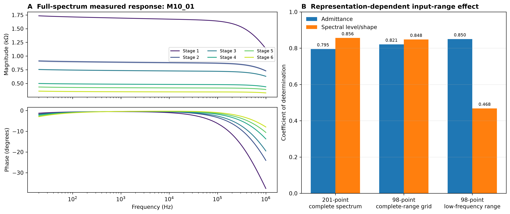
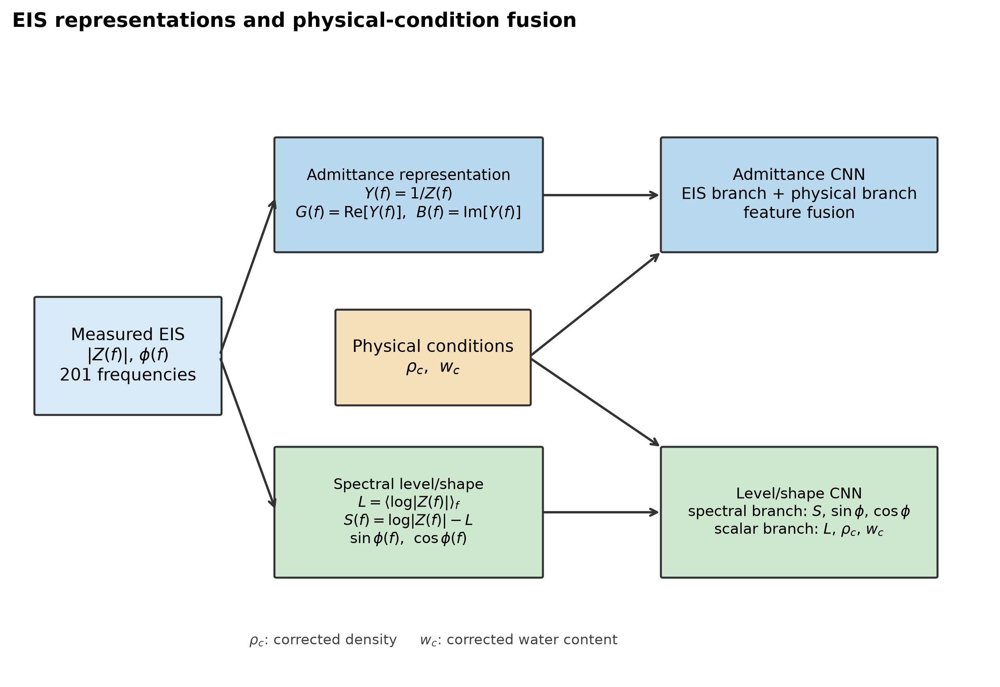
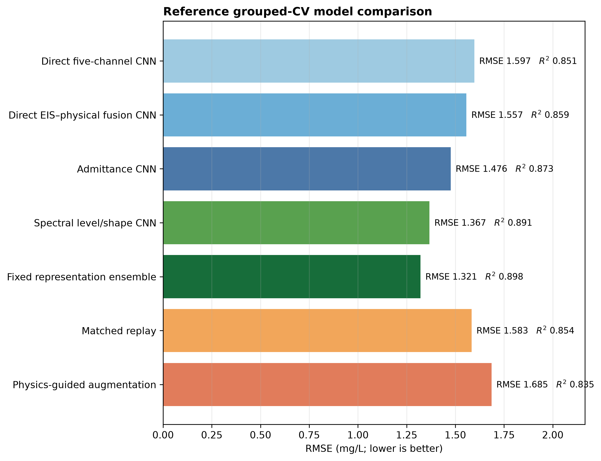
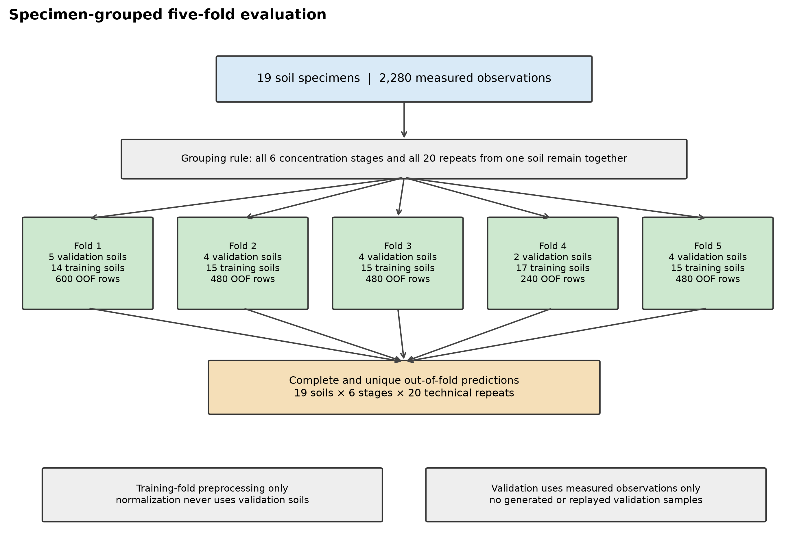
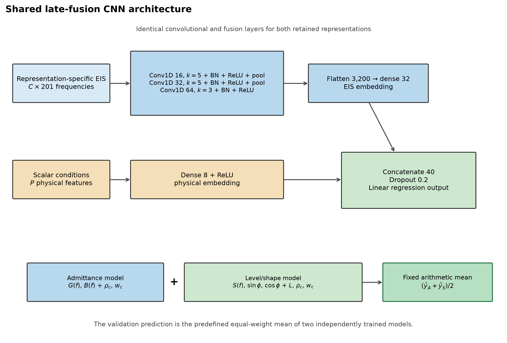
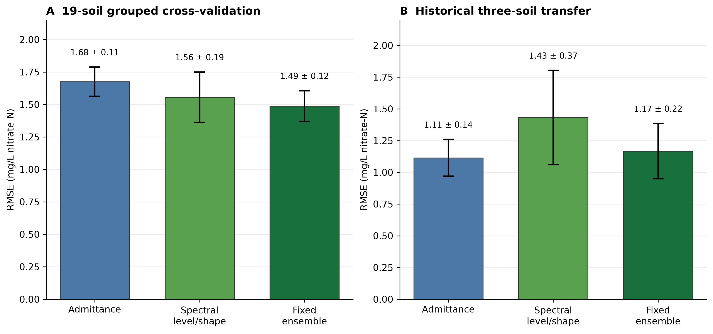
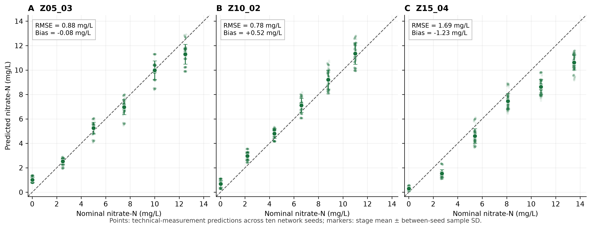
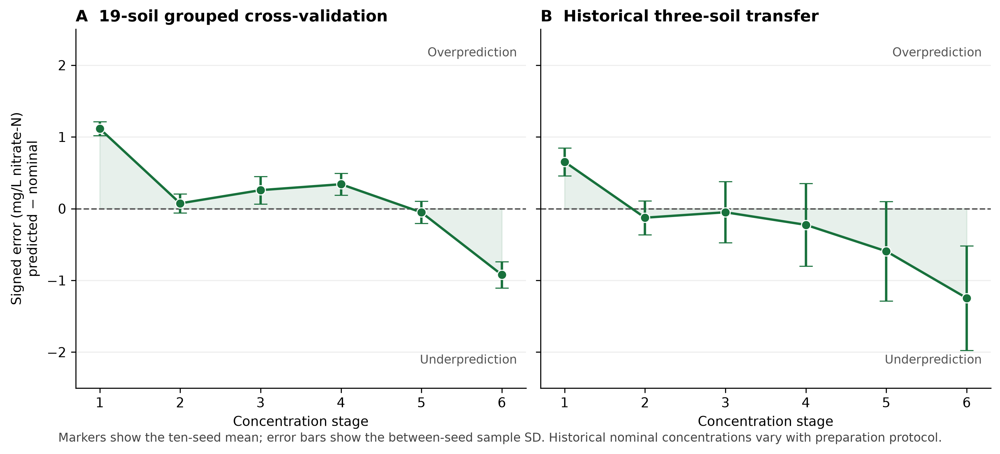

# Frequency-Resolved EIS for Soil Nitrate Estimation

Frequency-resolved electrochemical impedance spectroscopy (EIS) and complementary convolutional neural-network representations for estimating nitrate-N concentration in soil.

This repository presents a frozen research workflow based on the complete 201-point EIS spectrum from 20 Hz to 1 MHz. The study evaluates frequency information, physically motivated input representations, physics-guided data augmentation, specimen-grouped cross-validation, training-seed stability, and historical cross-cohort transfer.

## Main findings

- A fixed equal-weight ensemble of two complementary spectral representations achieved an out-of-fold coefficient of determination of **0.8983** and an RMSE of **1.3211 mg/L** in the frozen 19-soil, specimen-grouped five-fold evaluation at the reference network seed.
- Across ten predefined network seeds, the ensemble achieved a mean coefficient of determination of **0.8704 ± 0.0208** and a mean RMSE of **1.4874 ± 0.1183 mg/L**.
- Historical transfer to three held-out Z-series soils produced a ten-seed mean coefficient of determination of **0.9225 ± 0.0302** and a mean RMSE of **1.1666 ± 0.2181 mg/L** for the fixed ensemble.
- Combining admittance-based and spectral level/shape representations improved the primary grouped-CV performance relative to the individual CNN models.
- Direct five-channel convolution achieved a coefficient of determination of **0.8514** and an RMSE of **1.5973 mg/L**. Routing the same EIS and physical quantities through separate branches improved RMSE modestly to **1.5569 mg/L**, while the physically structured representations performed better.
- The evaluated physics-guided augmentation procedure generated physically feasible spectra but did not improve the primary grouped-CV prediction accuracy.
- Soil-specific errors and systematic endpoint bias remained important limitations: the lowest concentration was generally overestimated and the highest concentration was generally underestimated.

The value 0.8983 rounds to 0.90 when reported to two decimal places. This rounding does not imply that the unrounded value is greater than or equal to 0.9000.

## 1. Frequency-Resolved Impedance Information

Each observation contains impedance magnitude and phase measured at 201 original frequencies spanning 20 Hz to 1 MHz. The complete spectrum contains information in several forms:

- broadband impedance level;
- concentration-dependent spectral shape;
- frequency-dependent phase response;
- low-, intermediate-, and high-frequency transitions;
- interactions with corrected soil density and water content.

Controlled frequency-reduction experiments showed that information loss was representation-dependent. Retaining only a contiguous low-frequency subset removed high-frequency phase and shape information that was important for the spectral level/shape model. The frozen prediction workflow therefore preserves all 201 measured frequencies and does not apply smoothing or spectral interpolation.



**Figure 1. Frequency-resolved impedance information.** Full-spectrum magnitude and phase responses illustrate how concentration-dependent information is distributed across the measured frequency range. The controlled input-range comparison shows that complete-range sampling is especially important for the spectral level/shape representation.

## 2. Feature Representation and Model Selection

Two physically motivated EIS representations were retained.

### Admittance-based representation

Complex impedance is transformed into conductance and susceptance channels. This representation emphasizes the electrical response in the admittance domain while corrected density and water content enter a separate physical-condition branch.

### Spectral level/shape representation

The impedance response is separated into broadband level and centered frequency-dependent shape components, with phase information retained explicitly. Corrected density and water content again enter through a separate branch.

The two CNNs are combined using a predefined equal-weight arithmetic mean of their predictions. Ensemble weights were not optimized on held-out observations.

### Frozen reference-seed comparison

| Training and representation | Coefficient of determination | RMSE (mg/L) |
|---|---:|---:|
| Direct five-channel CNN, measured data only | 0.8514 | 1.5973 |
| Direct EIS–physical fusion CNN, measured data only | 0.8588 | 1.5569 |
| Admittance-based CNN, measured data only | 0.8731 | 1.4762 |
| Admittance-based CNN, matched replay | 0.8540 | 1.5832 |
| Admittance-based CNN, physics-guided augmentation | 0.8345 | 1.6854 |
| Spectral level/shape CNN, measured data only | 0.8911 | 1.3673 |
| **Fixed equal-weight representation ensemble** | **0.8983** | **1.3211** |



**Figure 2A. Physically motivated representations and late fusion.** The admittance model uses conductance and susceptance, whereas the level/shape model separates broadband impedance level from centered spectral shape and phase. Corrected density and water content enter through a separate scalar branch.



**Figure 2B. Frozen reference-seed model comparison.** The fixed equal-weight representation ensemble achieved the lowest RMSE. Physics-guided augmentation did not improve performance over measured-data training.



**Figure 3A. Specimen-grouped evaluation design.** All concentration stages and technical repeats from each soil remain together, producing complete and unique out-of-fold predictions without validation-soil leakage.



**Figure 3B. Shared CNN and late-fusion architecture.** Representation-specific EIS channels are processed by the same convolutional structure, then combined with a separate physical-condition embedding. The two independently trained models are combined using a fixed arithmetic mean.

## 3. Physics-Guided Data Augmentation

The evaluated generator applied a constrained, baseline-oriented transformation to measured EIS spectra. Generated observations were required to preserve predefined spectral, phase, metadata, label, and complex-impedance consistency conditions. A matched replay arm controlled for the increased number of sample presentations.

The generated spectra passed the technical physics audits, but augmentation did not improve the primary specimen-grouped prediction accuracy. This is an important negative result:

> Physical feasibility alone was not sufficient to reproduce the full cross-specimen variability needed to improve nitrate prediction.

The frozen project does not perform further generator tuning, augmentation-ratio searches, or post-hoc selection of augmentation settings.

## 4. Prediction Accuracy and Generalization

### Specimen-grouped five-fold evaluation

The primary population contained 19 soil specimens. Two specimens were excluded from the frozen sensitivity population before model fitting. All six concentration stages and all 20 technical repeats from one soil remained in the same validation fold.

| Evaluation | Coefficient of determination | RMSE (mg/L) | MAE (mg/L) |
|---|---:|---:|---:|
| Frozen reference seed | 0.8983 | 1.3211 | 1.0372 |
| Ten-seed mean | 0.8704 | 1.4874 | 1.1386 |
| Ten-seed sample standard deviation | 0.0208 | 0.1183 | 0.0857 |

The fixed ensemble outperformed the admittance-based CNN in all ten network seeds and ranked first among the predefined candidates in eight of ten seeds.



**Figure 4. Multi-seed stability.** Bars report mean RMSE across ten predefined network seeds; error bars show the sample standard deviation. The fixed ensemble was more accurate and less variable than either individual representation in the primary grouped evaluation.

### Historical cross-cohort transfer

Models fitted using all 19 eligible original soils were evaluated on three historical Z-series soils that were excluded from fitting and preprocessing estimation.

| Model | Mean coefficient of determination | Mean RMSE (mg/L) | RMSE standard deviation (mg/L) |
|---|---:|---:|---:|
| Admittance-based CNN | 0.9303 | 1.1146 | 0.1448 |
| Spectral level/shape CNN | 0.8799 | 1.4322 | 0.3708 |
| Fixed representation ensemble | 0.9225 | 1.1666 | 0.2181 |

The transfer results are promising but must be interpreted as historical cross-cohort transfer, not pristine prospective external validation. The Z-series soils were examined in earlier development analyses and were prepared using a different experimental protocol.



**Figure 5. Historical transfer predictions.** Technical-measurement predictions and stage summaries are shown for the three Z-series soils. Shared axes expose both the strong overall concentration tracking and the soil-specific negative bias for Z15_04.

## 5. Error Sources and Experimental Limitations

### Concentration-endpoint bias

Across network seeds, the lowest concentration stage was generally overestimated and the highest concentration stage was generally underestimated. This stable pattern indicates prediction-range contraction rather than an isolated unfavorable initialization.



**Figure 6. Concentration-stage error and endpoint bias.** Across network seeds, predictions exhibit range contraction: the lowest stage is overestimated and the highest stage is underestimated. Error bars represent between-seed sample standard deviation.

### Soil-specific errors

Several soils remained substantially harder to predict than the pooled average. In particular, some specimens exhibited locally weak, atypical, or nonmonotonic concentration-response behavior. These observations were retained in the scientific evaluation and were not removed to improve headline metrics.

### Experimental limitations

- Nineteen soils remain a limited population for unrestricted soil generalization.
- Technical EIS repeats are not independent soil or preparation replicates.
- Multi-seed analysis measures training randomness, not new-soil population uncertainty.
- The five specimen folds remain fixed across network seeds.
- The original soil cohort used sequential concentration increments on the same material.
- The Z-series cohort used separately prepared aliquots for each nominal concentration.
- Preparation protocol is completely associated with cohort identity, so protocol effects cannot be separated causally from soil-population effects.
- Chemical analysis has not established actual nitrate loss or concentration-label error.
- The three Z-series soils are historical transfer specimens, not a prospective external cohort.

## Figures

The publication figure specification is provided in [`docs/FIGURE_PLAN.md`](docs/FIGURE_PLAN.md). The final main-text order is:

1. Frequency-Resolved Impedance Information and CNN Input Design
2. Feature Representation Comparison and Model Selection
3. Experimental Design and Model Architecture
4. Multi-Seed Stability
5. Transfer Prediction: Predicted vs. Nominal
6. Concentration-Stage Error and Endpoint Bias

## Reproducibility scope

The public workflow will reproduce the frozen analyses without performing model, seed, augmentation, frequency, or ensemble-weight selection. Configuration files record the specimen folds, model settings, network seeds, training budgets, and evaluation definitions.

## Public data and quick start

The original MATLAB measurement files are included under `data/raw/` and released under CC BY 4.0. Each specimen contains impedance magnitude and phase arrays with dimensions `[201 frequencies, 20 technical repeats, 6 concentration stages]`.

Create the deterministic processed dataset:

```powershell
python scripts/build_dataset.py
```

Run the public data, representation, and model-contract tests from the repository root:

```powershell
$env:PYTHONPATH = "$PWD\src"
python -m pytest tests/test_public_data_and_models.py -q
```

The generated processed dataset is written to `data/processed/` and is excluded from version control because it can be rebuilt from the public raw files.

Reproduce the reference-seed grouped cross-validation and historical transfer evaluations:

```powershell
python scripts/run_reference_evaluation.py --scope both --seeds 42 --device auto --output-dir results/reproduced/reference_seed
```

Use `--resume` to continue from compatible atomic checkpoints after an interrupted run. The script writes observation-level predictions, machine-readable metrics, and a run audit to the selected output directory. It does not search over seeds, representations, folds, or ensemble weights.

Run the fixed seed-42 control comparing direct five-channel convolution with a separate physical-condition branch:

```powershell
python scripts/run_direct_input_comparison.py --device auto
```

This control uses the same 19-soil folds, measured observations, optimizer, and training budget as the reference evaluation. It does not tune the architecture or add network seeds.

Generate all publication figures from the public measurements and fixed numerical result tables:

```powershell
python scripts/make_figure_1_frequency_information.py
python scripts/make_figure_2a_representation_fusion.py
python scripts/make_figure_2b_model_comparison.py
python scripts/make_figure_3a_grouped_evaluation.py
python scripts/make_figure_3b_cnn_architecture.py
python scripts/make_figure_4_multiseed_stability.py
python scripts/make_figure_5_transfer_predictions.py
python scripts/make_figure_6_stage_error.py
```

Figure 1 uses the complete measured frequency grid in its spectral panel. Its controlled input-range comparison is a representation-specific diagnostic and is not used to select the reported 19-soil model after evaluation. Figure 2 reports the predefined reference-seed comparison, including the unfavorable augmentation result. Figures 4–6 use the frozen ten-seed result tables and do not perform model or seed selection.

## Repository structure

```text
configs/                  Frozen public experiment configuration
data/raw/                 Original public MATLAB EIS measurements
data/folds/               Frozen specimen-grouped fold assignments
docs/                     Results summary and figure specifications
scripts/                  Reproducible command-line workflows
src/frequency_eis/        Data, representation, and CNN implementation
tests/                    Public integrity and model-contract tests
results/reference/        Fixed numerical evidence tables for published results
results/reproduced/       Locally reproduced outputs (not version controlled)
figures/                  Reproducibly generated publication figures
```

No private data, internal checkpoints, or development-only artifacts should be committed to this repository.

## Repository status

The scientific results are frozen. Repository packaging, public scripts, figures, data-access documentation, and reproducibility instructions are being added in controlled steps.

